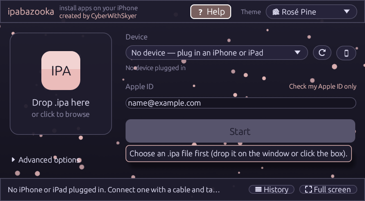

# ipabazooka

Install apps (`.ipa` files) on your iPhone or iPad from Windows. ipabazooka is a
beginner-friendly Sideloadly alternative. It explains how sideloading works,
walks you through each step, and comes with 23 themes.



## Download

Get the latest version from the **[Releases page](https://github.com/Sky3rshin/ipabazooka/releases/latest)**:

- **`ipabazooka.exe`** is the whole app in one file. There's no installer: download it and double-click it.
- **`ipabazooka-<version>-windows.zip`** contains the same exe plus `READ ME FIRST.txt`.

If Windows shows "Windows protected your PC", click **More info**, then **Run anyway**.
This warning appears for apps that aren't from the Microsoft Store or signed with a paid
code-signing certificate.

## What you need

- Windows 10 or 11 (64-bit)
- The **web versions** of iTunes and iCloud for Windows from apple.com. If you have the
  Microsoft Store versions, uninstall them first.
  - iTunes lets the app see your iPhone over USB.
  - iCloud lets the app create Apple's sign-in data on your PC, which makes Apple ID sign-in reliable.
- An Apple ID. A free one works: sideloaded apps last 7 days (then install them again;
  your saved data stays), and you can have up to 3 at once.

## How to use it

1. Plug in your iPhone or iPad with a cable, unlock it and tap **Trust**.
2. Drop an `.ipa` file on the box, or click the box to browse for one.
3. Pick your device and enter your Apple ID.
4. Click **Start** (or press **Alt+S**).

New to sideloading? Click **? Help** at the top of the app for a full walkthrough:
what sideloading is, how to get an `.ipa` (including tweaked apps), step-by-step
instructions, and fixes for common problems.

### Keyboard shortcuts

| Key     | Action                                           |
|---------|--------------------------------------------------|
| `Alt+S` | Start (once an app and a device are chosen)      |
| `Alt+.` | Show or hide the status history (the full log)   |
| `Alt+V` | Show or hide Advanced options                    |
| `F11`   | Full screen (`Esc` leaves it)                    |

### Themes

Pick a theme from the **Theme** menu in the top-right corner: Hacker, Normal,
Black & White, White on Black, Pink, Midnight, Sunset, Ocean, Catppuccin Mocha,
Catppuccin Latte, Nord, Everforest, Solarized Dark, Solarized Light, Dracula,
Tokyo Night, Gruvbox, Rosé Pine, One Dark, Monokai, Synthwave, Lava and Aurora.
Screenshots of each are in [`shots/`](shots/).

Your theme and logs are saved per PC in `%APPDATA%\ipabazooka`.

## Building from source

The app is written in Rust with [egui/eframe](https://github.com/emilk/egui).
Releases are built on Windows with the `stable-x86_64-pc-windows-gnu` toolchain.

```sh
cargo build --release   # -> target/release/ipabazooka.exe
cargo test              # unit tests + SRP sign-in proof check
```

During the build, `build.rs` does two things:

- It compiles `helper/anisette_helper.cs` with the C# compiler that ships with Windows
  (.NET Framework 4 `csc.exe`). This helper lets the app get sign-in data from this PC's
  iCloud for Windows. If the compiler is missing, the app falls back to online sign-in servers.
- It embeds the exe icon and version info using `windres` (MinGW), if available.

## Project layout

| Path | What it is |
|---|---|
| `src/main.rs` | The window: UI, layout, help panel, keyboard shortcuts |
| `src/sideload.rs` | Signs in to Apple, gets a free development certificate and profile, re-signs the app and installs it |
| `src/device.rs` | Finds plugged-in iPhones/iPads through the Apple Mobile Device service (usbmuxd) |
| `src/phone.rs` | Phone tools: list/remove installed apps, Developer Mode |
| `src/ipa.rs` | Reads app details out of an `.ipa` file |
| `src/local_anisette.rs` | "This PC" sign-in data from iCloud for Windows |
| `src/progress.rs` | Step-based progress bar |
| `src/theme.rs` | Themes: colours, fonts, wording and animated backgrounds |
| `helper/anisette_helper.cs` | Small 32-bit helper that talks to iCloud for Windows |
| `build.rs` | Builds the helper and embeds the exe icon/version info |
| `tests/srp_check.rs` | Checks the Apple sign-in (SRP) proof against an independent implementation |
| `vendor/isideload/` | Patched copy of the isideload library (see its `NOTICE.md`) |
| `dist/READ ME FIRST.txt` | The read-me that ships in the release zip |
| `MECHANICS.md`, `mechanics.json` | Notes on the behaviour rules the app follows |
| `shots/` | Screenshots |

## Credits

- [isideload](https://github.com/nab138/isideload) by nab138 (MIT License) handles Apple
  sign-in, signing and installing. A patched copy is in [`vendor/isideload`](vendor/isideload)
  with its [license](vendor/isideload/LICENSE) and a [list of changes](vendor/isideload/NOTICE.md).
- [idevice](https://github.com/jkcoxson/idevice) by jkcoxson handles talking to the device.
- [egui / eframe](https://github.com/emilk/egui) provides the user interface.

Created by **CyberWithSkyer**.
