<a id="top"></a>

<div align="center">


# ipabazooka

### Install apps on your iPhone or iPad from Windows or Linux. No jailbreak, no experience needed.

A beginner-friendly Sideloadly alternative that explains what it's doing,<br>
walks you through every step, and looks good doing it with 23 themes.

<br>

<a href="https://github.com/Sky3rshin/ipabazooka/releases/latest/download/ipabazooka.exe"></a>
&nbsp;
<a href="#linux"></a>

<a href="https://github.com/Sky3rshin/ipabazooka/releases/latest"></a>
<a href="https://github.com/Sky3rshin/ipabazooka/releases"></a>


<a href="https://github.com/Sky3rshin/ipabazooka/actions/workflows/linux.yml"></a>


<br>

**[Features](#features)** &nbsp;·&nbsp;
**[Download](#download)** &nbsp;·&nbsp;
**[Linux](#linux)** &nbsp;·&nbsp;
**[Quick start](#quick-start)** &nbsp;·&nbsp;
**[Full guide](#step-by-step-guide)** &nbsp;·&nbsp;
**[Themes](#themes)** &nbsp;·&nbsp;
**[Troubleshooting](#troubleshooting)** &nbsp;·&nbsp;
**[FAQ](#faq)**

<br>

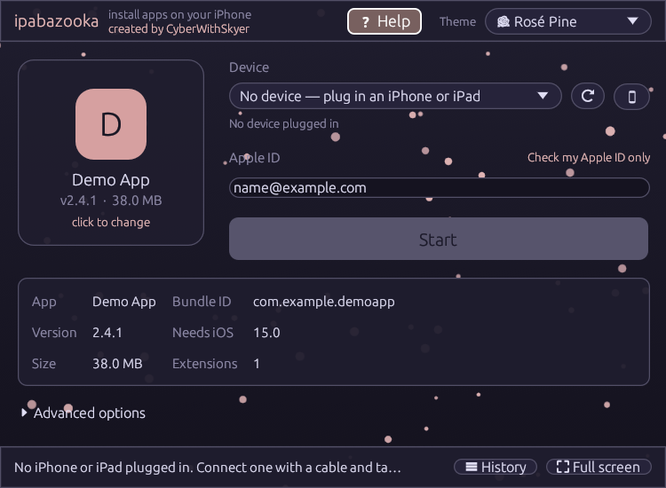

</div>

<br>

## Features

<table>
<tr>
<td width="50%" valign="top">

**One file, nothing to install**<br>
`ipabazooka.exe` is the whole app. Download it and double-click it. Keep it on your desktop or a USB stick.

</td>
<td width="50%" valign="top">

**Built-in teacher**<br>
The **? Help** button explains what sideloading is, how to get an `.ipa`, every step of using the app, and what to do when something goes wrong.

</td>
</tr>
<tr>
<td valign="top">

**Drag, drop, done**<br>
Drop an `.ipa` on the window and you'll see its name, version, bundle ID, required iOS version, size and extensions before anything happens.

</td>
<td valign="top">

**Finds your phone automatically**<br>
Plugged-in iPhones and iPads appear on their own within a few seconds, with their name, model and iOS version.

</td>
</tr>
<tr>
<td valign="top">

**Errors in plain English**<br>
When Apple returns an error code, ipabazooka tells you what it means and **what to do next**, not just a number.

</td>
<td valign="top">

**Check your Apple ID first**<br>
**Check my Apple ID only** signs in and shows how many certificates and App IDs your account has left. No phone or app needed.

</td>
</tr>
<tr>
<td valign="top">

**Power-user options**<br>
Rename the app, change its bundle ID, remove device limits, enable Files sharing, strip extensions, raise the memory limit, or export a signed `.ipa` instead of installing.

</td>
<td valign="top">

**Phone tools**<br>
See the apps you've installed, remove them, check Developer Mode and make its switch appear in Settings, all from your PC.

</td>
</tr>
<tr>
<td valign="top">

**Windows and Linux**<br>
A single exe on Windows, and on Linux a `.deb`, `.rpm`, Arch package, AppImage or portable folder. On Windows it can even use Apple's own iCloud for Windows to create the most trusted kind of sign-in data.

</td>
<td valign="top">

**23 themes**<br>
From a plain light theme to Hacker-style digital rain, Synthwave, Catppuccin, Dracula, Nord and more, many with animated backgrounds.

</td>
</tr>
</table>

<br>

## What is sideloading?

Normally, iPhone and iPad apps come from the App Store. **Sideloading** means putting an app on your phone yourself, from your computer, without the App Store.

- An iPhone app comes as one file whose name ends in **`.ipa`**. Think of it as the app in a box.
- iPhones only open apps that are **signed** (approved). ipabazooka signs the `.ipa` with **your own free Apple ID**, so your phone accepts it.
- You don't need to jailbreak, and you don't need a paid Apple developer account.

### Free Apple ID limits

These limits come from Apple, not ipabazooka:

| Limit | What it means for you |
|---|---|
| **7 days** | A sideloaded app works for 7 days. Then install it again with ipabazooka. **Your data inside the app stays.** |
| **3 apps at once** | A free Apple ID can have up to 3 sideloaded apps on a phone at the same time. |
| **10 App IDs per 7 days** | Each app uses one App ID, and each of its extensions (widgets, share sheets) uses another. See [Advanced options](#advanced-options) for ways to use fewer. |
| **A few signing certificates** | If your Apple ID was used with Sideloadly, AltStore or another PC, you may be asked to revoke an old certificate. That's normal. |

<br>

## Download

<div align="center">

<a href="https://github.com/Sky3rshin/ipabazooka/releases/latest/download/ipabazooka.exe"></a>
&nbsp;
<a href="#linux"></a>
&nbsp;
<a href="https://github.com/Sky3rshin/ipabazooka/releases/latest"></a>

</div>

### Windows

| File | What it is |
|---|---|
| **`ipabazooka.exe`** | The whole app in one file. No installer. Just double-click it. |
| **`ipabazooka-<version>-windows.zip`** | The same exe plus `READ ME FIRST.txt`, handy for copying to another PC. |

> [!NOTE]
> **"Windows protected your PC"?** Click **More info**, then **Run anyway**. Windows shows this for apps that aren't from the Microsoft Store or signed with a paid code-signing certificate.

<details>
<summary><b>Optional: check that your download isn't damaged or tampered with</b></summary>

<br>

Each release lists the SHA-256 checksum of its files. In PowerShell, run:

```powershell
Get-FileHash "$env:USERPROFILE\Downloads\ipabazooka.exe" -Algorithm SHA256
```

The `Hash` it prints should match the one on the [release page](https://github.com/Sky3rshin/ipabazooka/releases/latest).

</details>

### Linux

Pick the download for your distribution from the **[latest release](https://github.com/Sky3rshin/ipabazooka/releases/latest)**. The `.deb`, `.rpm` and Arch packages add ipabazooka to your app menu, let you open `.ipa` files with it, and **install `usbmuxd` for you**. `usbmuxd` is the small service that lets Linux talk to an iPhone or iPad.

| Your distribution | Download | Install it with |
|---|---|---|
| **Debian, Ubuntu, Linux Mint, Pop!_OS, Zorin, elementary** | `ipabazooka_<version>_amd64.deb` | `sudo apt install ./ipabazooka_*_amd64.deb` |
| **Fedora, RHEL, AlmaLinux, Rocky, Nobara** | `ipabazooka-<version>-1.x86_64.rpm` | `sudo dnf install ./ipabazooka-*.x86_64.rpm` |
| **openSUSE Tumbleweed / Leap** | `ipabazooka-<version>-1.x86_64.rpm` | `sudo zypper install --allow-unsigned-rpm ./ipabazooka-*.x86_64.rpm` |
| **Arch, Manjaro, EndeavourOS, CachyOS, Garuda** | `ipabazooka-<version>-1-x86_64.pkg.tar.zst` | `sudo pacman -U ./ipabazooka-*-x86_64.pkg.tar.zst` |
| **Any distribution, nothing to install** | `ipabazooka-<version>-x86_64.AppImage` | `chmod +x ipabazooka-*.AppImage` then run it |
| **Any distribution, portable folder** | `ipabazooka-<version>-linux-x86_64.tar.gz` | unpack it, then run `./ipabazooka`, or `./install.sh` to add it to your app menu |

> [!NOTE]
> With the **AppImage** or the **portable folder**, install `usbmuxd` yourself once: `sudo apt install usbmuxd` (Debian/Ubuntu), `sudo dnf install usbmuxd` (Fedora), `sudo zypper install usbmuxd` (openSUSE) or `sudo pacman -S usbmuxd` (Arch).

<details>
<summary><b>Linux requirements and details</b></summary>

<br>

- **64-bit (x86_64) Linux with glibc 2.28 or newer**: Debian 10+, Ubuntu 20.04+, Fedora 29+, RHEL/AlmaLinux/Rocky 8+, openSUSE Leap 15+, Arch and its relatives. Alpine and other musl-based systems aren't supported.
- **A graphical desktop**: X11 or Wayland (GNOME, KDE Plasma, Xfce, Cinnamon, MATE and others).
- The "choose a file" window uses your desktop's file picker (`xdg-desktop-portal`), or `zenity` if that isn't available. Dragging an `.ipa` onto the window always works.
- Every package is tested automatically on Debian 12 and 13, Ubuntu 22.04 and 24.04, Fedora, AlmaLinux 9, openSUSE Tumbleweed and Arch Linux by [installing it on a fresh system and opening the app](https://github.com/Sky3rshin/ipabazooka/actions/workflows/linux.yml).
- **Arch users:** the release also includes the `PKGBUILD`, so you can build the package yourself with `makepkg -si`.
- **Check your download:** `sha256sum ipabazooka*` should match `SHA256SUMS-linux.txt` on the release page.

</details>

<br>

## Before you start

You only need to do this **once per computer**.

**On every computer:**

| You need | Why |
|---|---|
| **An Apple ID** | A free one works. **A spare Apple ID is the safest choice.** |
| **A cable** for your iPhone or iPad | A USB connection is the most reliable. |

**On Windows (10 or 11, 64-bit):**

| You need | Why |
|---|---|
| **iTunes for Windows**, the version from **apple.com** | It installs the Apple Mobile Device service that lets ipabazooka see your iPhone over USB. |
| **iCloud for Windows**, the version from **apple.com** | It lets ipabazooka create Apple's sign-in data on your PC, which makes Apple ID sign-in work reliably. |

> [!IMPORTANT]
> On Windows, use the **web (apple.com) versions** of iTunes and iCloud, **not the Microsoft Store versions**. If you already have the Microsoft Store versions, uninstall them first.

**On Linux:**

| You need | Why |
|---|---|
| **usbmuxd** | It lets ipabazooka see your iPhone over USB. The `.deb`, `.rpm` and Arch packages install it automatically. Linux starts it by itself whenever you plug in a phone. |

On Linux, Apple's sign-in data comes from online sign-in servers, because iCloud for Windows doesn't exist there. Nothing to install.

<br>

## Quick start

<table>
<tr>
<td width="55%" valign="top">

1. **Plug in** your iPhone or iPad, unlock it, and tap **Trust**.
2. **Drop** an `.ipa` file onto the big box (or click the box to choose one).
3. Check your phone shows under **Device**.
4. Type your **Apple ID** email.
5. Press **Start** (or <kbd>Alt</kbd>+<kbd>S</kbd>). Enter your password, and the 6-digit code if Apple sends one.
6. On the phone: **Settings › General › VPN & Device Management** › tap your Apple ID › **Trust**.
7. On iOS 16 or newer, turn on **Developer Mode** (Settings › Privacy & Security). Then open the app.

New to this? Read the **[full guide](#step-by-step-guide)** below, or press **? Help** in the app.

</td>
<td width="45%" valign="top">

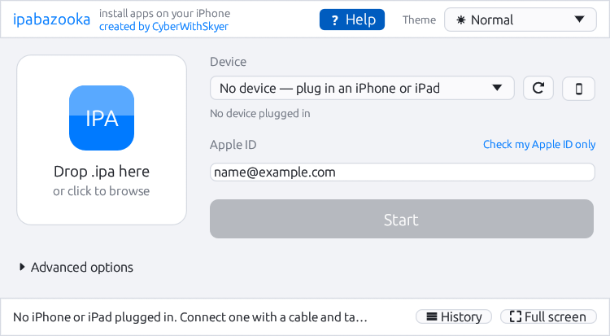

<sub>ipabazooka the first time you open it (Normal theme).</sub>

</td>
</tr>
</table>

<br>

## Step-by-step guide

### 1. Connect your iPhone or iPad

Plug the phone into your PC with a cable and unlock it. If it asks **"Trust This Computer?"**, tap **Trust** and enter your passcode.

ipabazooka looks for devices on its own every few seconds. Your phone appears in the **Device** list with its name, and the list shows whether it's connected by USB or Wi-Fi. Use the **⟳** button next to the list to look again right away.

> [!TIP]
> No phone showing? Unplug and replug the cable, unlock the phone, and tap **Trust**. On Windows, make sure **iTunes from apple.com** is installed. On Linux, make sure **usbmuxd** is installed. If the Trust prompt never appears on Linux, run `idevicepair pair` (from the `libimobiledevice-utils` or `libimobiledevice` package).

### 2. Choose the app (`.ipa`)

Drop the `.ipa` file onto the big box on the left, or click the box to browse for it. You can also right-click an `.ipa` file and choose **Open with › ipabazooka.exe**.

Once it's loaded, the box shows the app's name, version and size, and a details card shows its **bundle ID**, the **iOS version it needs**, and how many **extensions** it has.

<div align="center">

<br><sub>An app loaded and ready. The details card shows what's inside before you install anything.</sub>
</div>

<details>
<summary><b>Where do I get an <code>.ipa</code> file?</b></summary>

<br>

A **tweaked app** is a changed version of an app with extra features. To get an `.ipa`:

1. Search the web for the app's name plus "IPA", for example *"app name IPA"* or *"app name tweaked IPA"*.
2. Download the `.ipa` for that app. It usually ends up in your **Downloads** folder.
3. If it came inside a `.zip`, open the zip and take out the file that ends in `.ipa`.
4. Drop that `.ipa` into ipabazooka.

> **⚠️ Stay safe:** only download from sites and people you trust, let your antivirus check the file, and only install apps you're allowed to use. A file from an unknown place can hide harmful code.

</details>

### 3. Enter your Apple ID

Type your Apple ID email in the **Apple ID** box. A spare Apple ID is the safest choice.

Not sure your Apple ID will work? Click **Check my Apple ID only** (top right of the Apple ID box). It signs in and reports how many **signing certificates** and **App IDs** your account has left. You don't need a phone or app for this.

### 4. Press Start

Press **Start** (or <kbd>Alt</kbd>+<kbd>S</kbd>). It lights up once an app is chosen and a device is selected.

- **Password:** a window asks for your Apple ID password. It goes **only to Apple** and is **never written to the log**. Tick **Show password** to check for typos.
- **Two-factor code:** if Apple sends a 6-digit code to your other devices, type it into the **Two-factor code** window.
- **Certificate limit:** if your Apple ID already has the most certificates Apple allows, a **Certificate limit reached** window lists them with where each was made and when it expires. Pick an old one to revoke. Apps signed with a revoked certificate stop opening until you reinstall them.

### 5. Watch it work

ipabazooka signs in, gets a free development certificate and profile, re-signs the app, and installs it on your phone. The bar at the bottom of the window shows the current step and a percentage. Press **☰ History** (<kbd>Alt</kbd>+<kbd>.</kbd>) to see every step as it happens.

If something fails, a **Something went wrong** window explains the problem in plain words and tells you **what to do**, with buttons to open or copy the log.

### 6. Trust the app on your phone

The first time you install with an Apple ID, your phone needs to trust it:

1. Open **Settings › General › VPN & Device Management**.
2. Tap your Apple ID under *Developer App*, then tap **Trust**.

### 7. Turn on Developer Mode (iOS 16 or newer)

1. Open **Settings › Privacy & Security › Developer Mode** and turn it on.
2. Restart the phone when it asks, and confirm after the restart.

Don't see Developer Mode in Settings? Open [Phone tools](#phone-tools) and press **Show the switch in Settings**.

### 8. Enjoy, and renew every 7 days

Open the app on your phone. With a free Apple ID it works for **7 days**. To renew, repeat steps 1 to 5. Your data inside the app stays.

<br>

## The built-in Help

Press **? Help** at the top of the window. It's highlighted until you've opened it once. The guide is split into four parts, and you can click a title to open it:

<table>
<tr>
<td width="50%" align="center" valign="top">
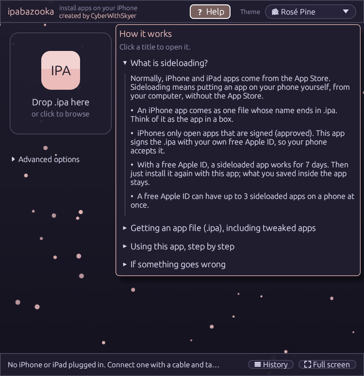<br>
<sub><b>What is sideloading?</b></sub>
</td>
<td width="50%" align="center" valign="top">
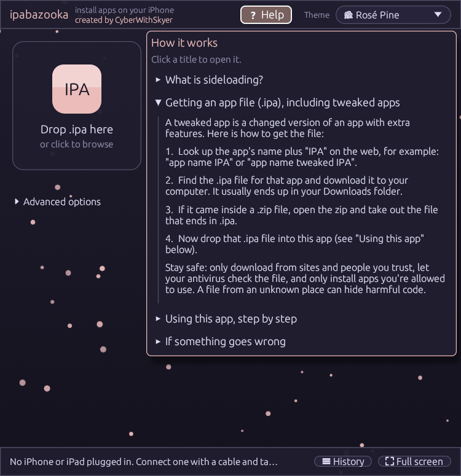<br>
<sub><b>Getting an app file (.ipa), including tweaked apps</b></sub>
</td>
</tr>
<tr>
<td align="center" valign="top">
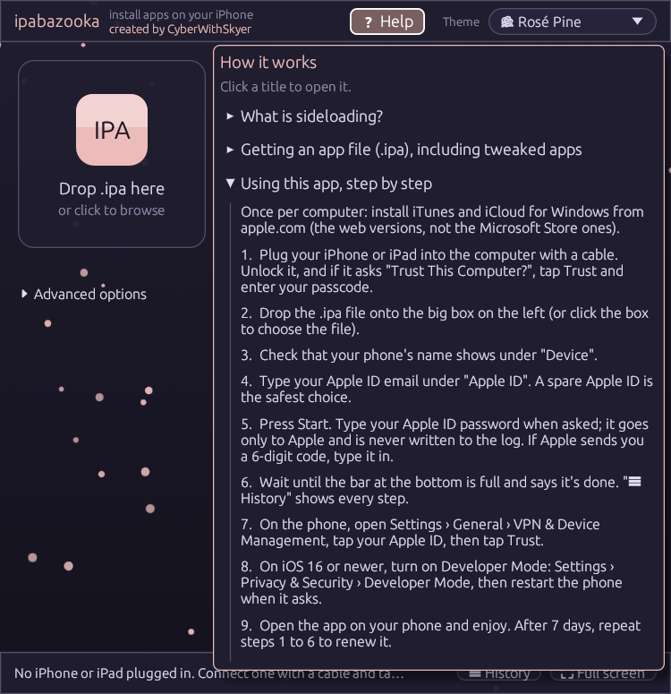<br>
<sub><b>Using this app, step by step</b></sub>
</td>
<td align="center" valign="top">
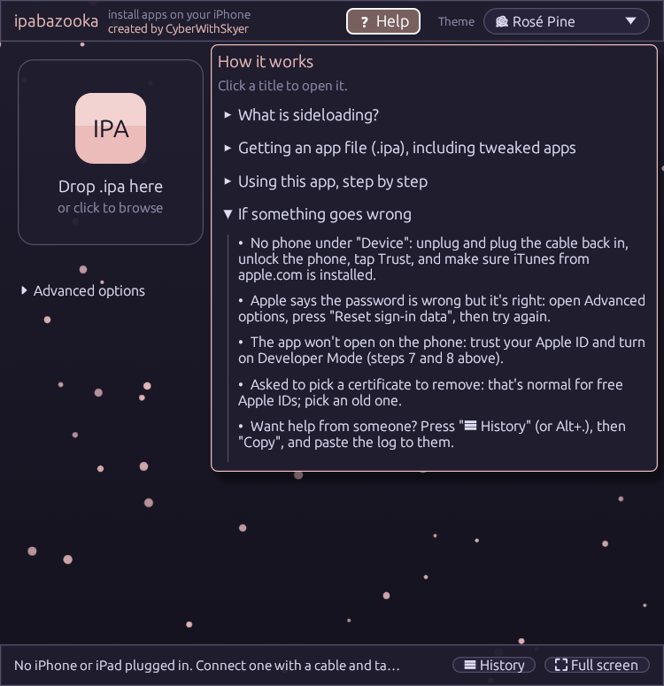<br>
<sub><b>If something goes wrong</b></sub>
</td>
</tr>
</table>

<br>

## Advanced options

Click **Advanced options** (or press <kbd>Alt</kbd>+<kbd>V</kbd>) to show extra settings. You don't need any of them for a normal install.

<table>
<tr>
<td width="46%" valign="top">

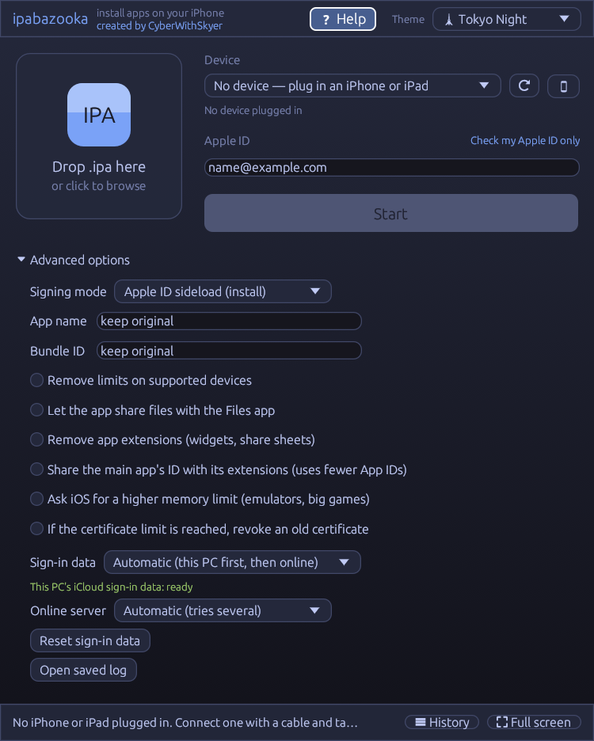

</td>
<td width="54%" valign="top">

| Option | What it does |
|---|---|
| **Signing mode** | **Apple ID sideload (install)** installs on your phone. **Export signed .ipa only** saves a signed copy named `<name>-signed.ipa` next to the original, with no phone needed. |
| **App name** | Shows the app under a different name on your home screen. |
| **Bundle ID** | Gives the app a different ID (like `com.example.myapp`), so you can install it next to another copy. |
| **Remove limits on supported devices** | Lets an app install even if it says it needs a newer iOS or a different device. |
| **Share files with the Files app** | Makes the app's documents visible in the Files app. |
| **Remove app extensions** | Strips widgets, share sheets and so on. This saves App IDs. |
| **Share the main app's ID with its extensions** | Extensions reuse the main App ID instead of each using their own. |
| **Higher memory limit** | Asks iOS for more memory (useful for emulators and big games). |
| **Revoke an old certificate** | Automatically makes room when you've hit the certificate limit. |
| **Sign-in data** *(Windows)* | **Automatic** (this PC first, then online), **This PC only**, or **Online servers only**. On Linux, the online servers are always used. |
| **Online server** | Which public sign-in data server to use, or **Custom…** for your own. |
| **Reset sign-in data** | Clears saved sign-in data so fresh data is made. Try this when Apple says your password is wrong but it isn't. |
| **Open saved log** | Opens the full log file in Notepad (Windows) or your default text viewer (Linux). |

</td>
</tr>
</table>

<br>

## Phone tools

With your phone plugged in, click the **phone button** next to the Device list to open **Phone tools**:

- **Device info:** name, model, iOS version, connection type, and its **UDID** with a **Copy** button.
- **Developer Mode:** **Check** whether it's on, or **Show the switch in Settings** to make the Developer Mode option appear on the phone.
- **Apps you installed:** a list of the apps you put on the phone, each marked *sideloaded* or *App Store*. Press **Remove** (then **Yes, remove**) to delete one, which is handy for freeing up one of your 3 app slots.

<br>

## Log and history

<table>
<tr>
<td width="50%" valign="top">

Press **☰ History** at the bottom (or <kbd>Alt</kbd>+<kbd>.</kbd>) to show the full log of everything ipabazooka did.

- **Copy** puts the whole log on your clipboard, ready to paste to someone helping you.
- **Saved log** opens the log file, which includes extra detail.
- **Clear** empties the on-screen log.

The log is also saved to `%APPDATA%\ipabazooka\ipabazooka.log` on Windows, or `~/.config/ipabazooka/ipabazooka.log` on Linux. **Your password is never written to it.** It does include your Apple ID email address, so keep that in mind before posting it publicly.

</td>
<td width="50%" valign="top">

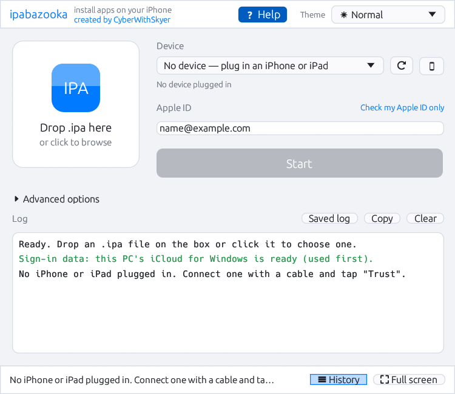

</td>
</tr>
</table>

<br>

## Themes

Pick a theme from the **Theme** menu in the top-right corner. Your choice is remembered. Many themes have animated backgrounds, and the **Hacker** theme switches the whole app to terminal-style wording (`[ EXECUTE ]`, `> TERMINAL`, `[ test login ]`).

<div align="center">
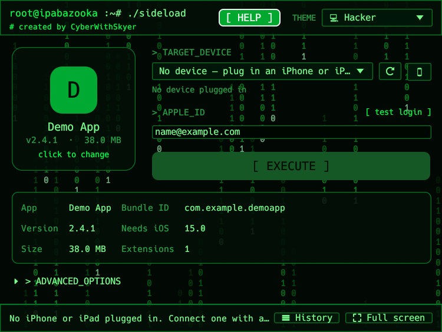
<br><sub>The Hacker theme, with falling green 0s and 1s.</sub>
</div>

<br>

<table>
<tr>
<td align="center" width="33%">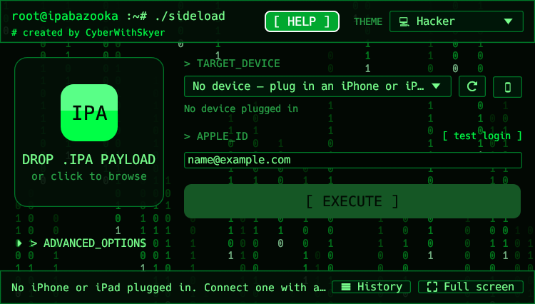<br><sub><b>Hacker</b></sub></td>
<td align="center" width="33%"><br><sub><b>Normal</b></sub></td>
<td align="center" width="33%">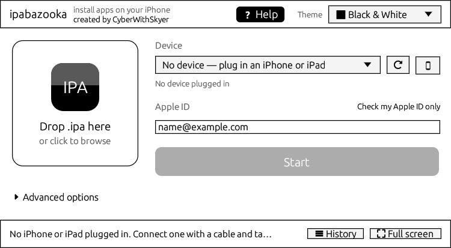<br><sub><b>Black &amp; White</b></sub></td>
</tr>
<tr>
<td align="center">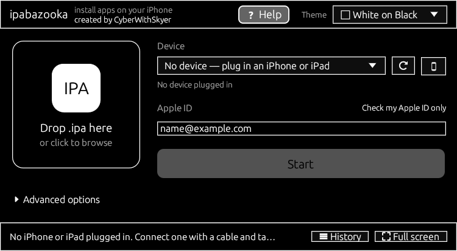<br><sub><b>White on Black</b></sub></td>
<td align="center">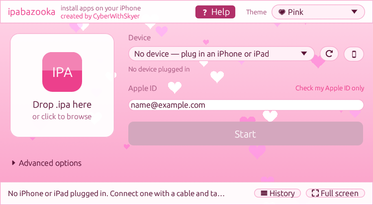<br><sub><b>Pink</b></sub></td>
<td align="center">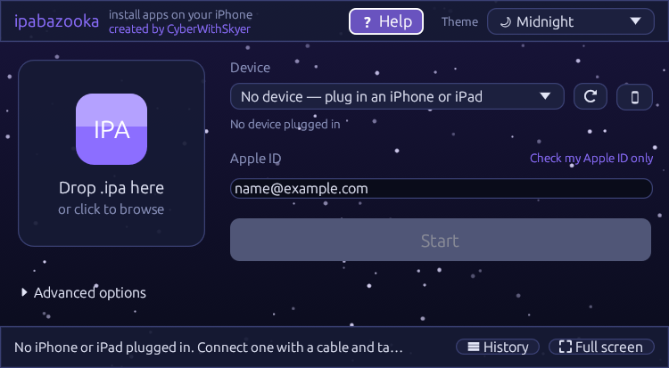<br><sub><b>Midnight</b></sub></td>
</tr>
<tr>
<td align="center">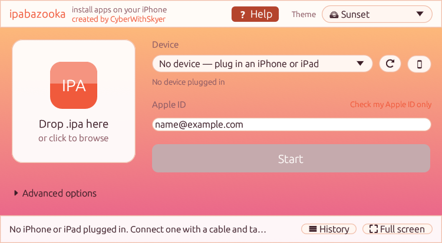<br><sub><b>Sunset</b></sub></td>
<td align="center">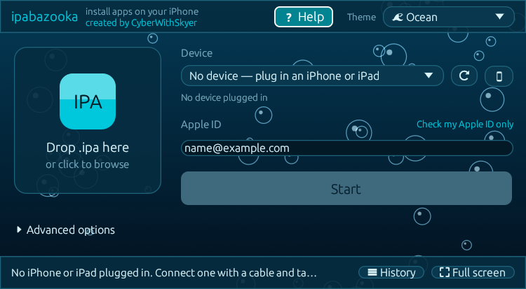<br><sub><b>Ocean</b></sub></td>
<td align="center">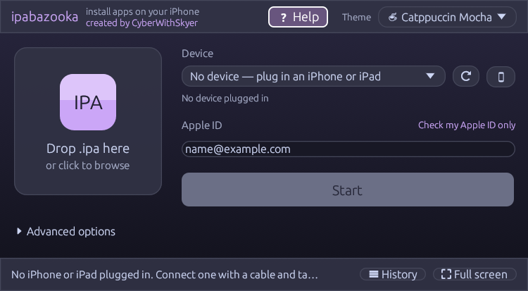<br><sub><b>Catppuccin Mocha</b></sub></td>
</tr>
<tr>
<td align="center">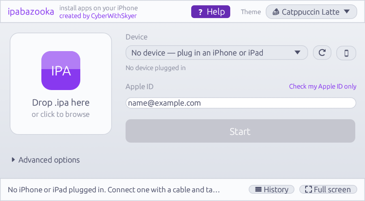<br><sub><b>Catppuccin Latte</b></sub></td>
<td align="center">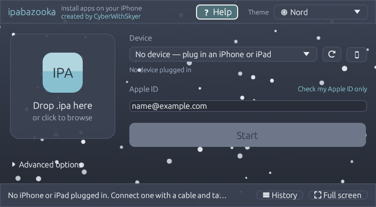<br><sub><b>Nord</b></sub></td>
<td align="center">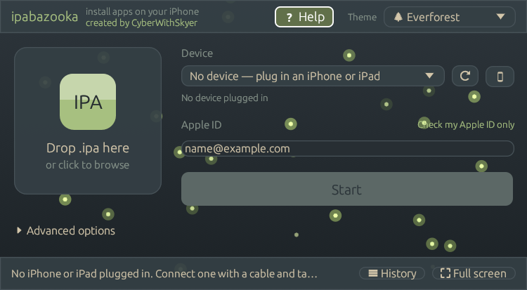<br><sub><b>Everforest</b></sub></td>
</tr>
<tr>
<td align="center">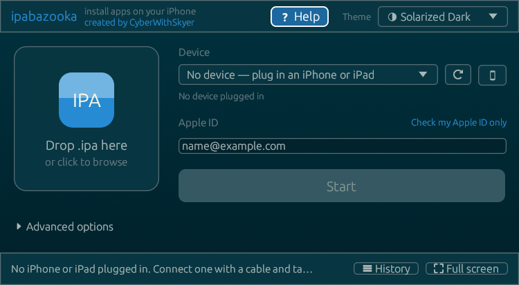<br><sub><b>Solarized Dark</b></sub></td>
<td align="center">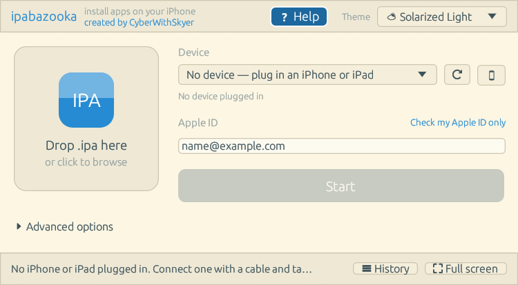<br><sub><b>Solarized Light</b></sub></td>
<td align="center">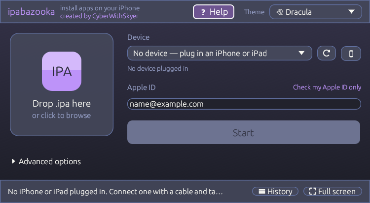<br><sub><b>Dracula</b></sub></td>
</tr>
<tr>
<td align="center">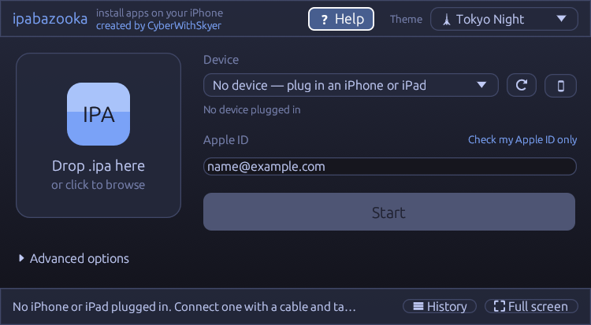<br><sub><b>Tokyo Night</b></sub></td>
<td align="center">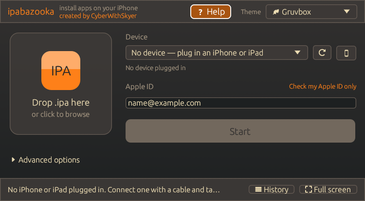<br><sub><b>Gruvbox</b></sub></td>
<td align="center">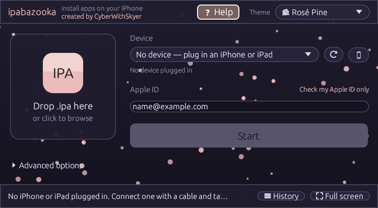<br><sub><b>Rosé Pine</b></sub></td>
</tr>
<tr>
<td align="center">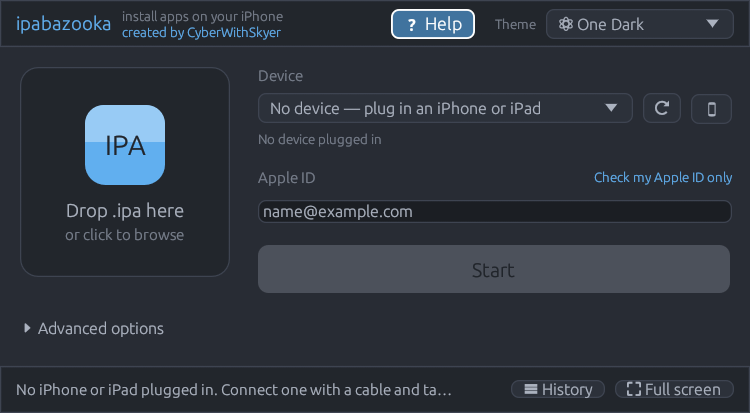<br><sub><b>One Dark</b></sub></td>
<td align="center">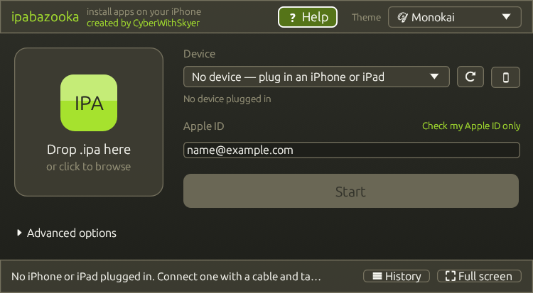<br><sub><b>Monokai</b></sub></td>
<td align="center">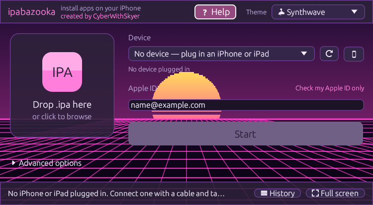<br><sub><b>Synthwave</b></sub></td>
</tr>
<tr>
<td align="center">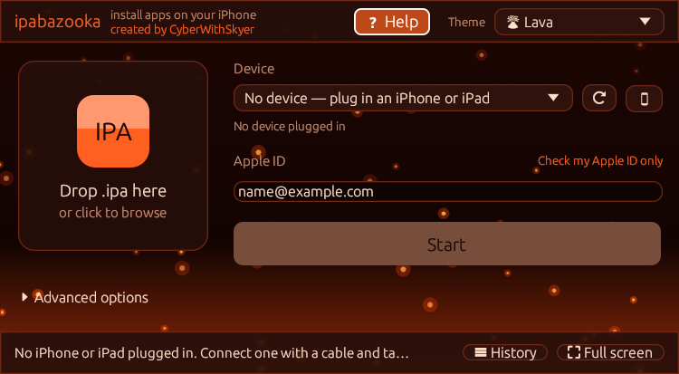<br><sub><b>Lava</b></sub></td>
<td align="center">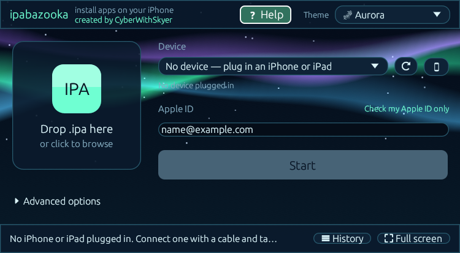<br><sub><b>Aurora</b></sub></td>
<td></td>
</tr>
</table>

<br>

## Keyboard shortcuts

| Keys | Action |
|---|---|
| <kbd>Alt</kbd> + <kbd>S</kbd> | **Start** (once an app and a device are chosen) |
| <kbd>Alt</kbd> + <kbd>.</kbd> | Show or hide the **status history** (the full log) |
| <kbd>Alt</kbd> + <kbd>V</kbd> | Show or hide **Advanced options** |
| <kbd>F11</kbd> | **Full screen** on or off (<kbd>Esc</kbd> leaves it) |

<br>

## Troubleshooting

ipabazooka recognizes Apple's common errors and shows a **"What to do"** tip with each one. Here they all are in one place:

| Problem or message | What to do |
|---|---|
| **No phone under "Device"** | Unplug and replug the cable, unlock the phone, tap **Trust**, and press **⟳** to look again. **Windows:** make sure **iTunes from apple.com** (not the Microsoft Store version) is installed. **Linux:** make sure **usbmuxd** is installed (the status says *usbmuxd missing* if it isn't). If the Trust prompt never appears, run `idevicepair pair`. |
| **Phone isn't paired** / *PairingDialogResponsePending*, *PasswordProtected* | Unlock the phone, tap **Trust** when asked, enter your passcode, and try again. |
| **"Apple ID or password incorrect"** (-22406) when the password is right | Open Advanced options › **Reset sign-in data** and try again. On Windows, make sure the web versions of iTunes and iCloud for Windows are installed, and keep *Sign-in data* on **Automatic**. On Linux, try another **Online server** in Advanced options. Use your **normal** Apple ID password (not an app-specific one), and sign in with the main email shown at account.apple.com › Sign-In and Security. Two-factor authentication must be **on**, and **security keys** on the account block tools like this. Tick **Show password** to check for typos. |
| **Sign-in data not accepted** (-22410) | This is about the computer's sign-in data, not your password. Make sure your clock is set automatically. On Windows, open **iCloud for Windows** once and sign in with the same Apple ID. On Linux, press **Reset sign-in data** or pick another **Online server**. Then try again. |
| **Apple ID is locked** (-20209) | Unlock it at iforgot.apple.com, then try again. |
| **Certificate limit reached** (7460) | Pick an old certificate to revoke when asked, or tick **Revoke an old certificate** in Advanced options. Apps signed with a revoked certificate stop opening until you reinstall them. |
| **App ID limit reached** (9401) | Free Apple IDs can make 10 App IDs every 7 days. Tick **Remove app extensions** or **Share the main app's ID** in Advanced options, or wait a few days. |
| **Developer agreement not accepted** | Sign in once at developer.apple.com/account in a web browser, accept the agreement, and try again. |
| **No developer team** | Sign in once at developer.apple.com/account to set up the free team, then try again. |
| **Device limit reached** | Remove old devices at developer.apple.com/account, or use another Apple ID. |
| **A copy signed by someone else is already on the phone** | Delete it from the phone (or use **Phone tools › Remove**), or set a different **Bundle ID** in Advanced options. |
| **App needs a newer iOS** | Tick **Remove limits on supported devices** in Advanced options to try anyway. |
| **The phone rejected the app's signature** | Try again. If it keeps happening, revoke old certificates and reinstall. |
| **Apple's session expired** (1100) | Press **Start** again. |
| **The app installed but won't open** | Trust your Apple ID (**Settings › General › VPN & Device Management**) and turn on **Developer Mode** on iOS 16+. |
| **The app stopped opening after a week** | That's the 7-day limit for free Apple IDs. Install it again with ipabazooka. Your data stays. |
| **Still stuck?** | Press **☰ History** › **Copy** and paste the log to whoever is helping you. Your password is never in it, but your Apple ID email is. |

<br>

## FAQ

<details>
<summary><b>Is ipabazooka free?</b></summary>
<br>
Yes. You also don't need a paid Apple developer account. A free Apple ID works.
</details>

<details>
<summary><b>Do I need to jailbreak my phone?</b></summary>
<br>
No. Sideloading with an Apple ID works on a normal, un-jailbroken iPhone or iPad.
</details>

<details>
<summary><b>Is my Apple ID password safe?</b></summary>
<br>
Your password is sent <b>only to Apple</b> to sign in. It is never written to the log or saved by ipabazooka. Even so, <b>a spare Apple ID is the safest choice</b> for any sideloading tool.
</details>

<details>
<summary><b>What is "sign-in data" (anisette)?</b></summary>
<br>
Apple wants extra "machine identity" data along with every sign-in. On Windows, ipabazooka gets it from Apple's own <b>iCloud for Windows</b> on your PC when it can (the most trusted kind). Otherwise, and always on Linux, it uses public sign-in data servers. These servers never see your password. On Windows you can choose <b>This PC only</b> in Advanced options to avoid online servers entirely.
</details>

<details>
<summary><b>Why does the app stop working after 7 days?</b></summary>
<br>
Apps signed with a free Apple ID expire after 7 days. That's Apple's rule. Just install it again with ipabazooka, and your data inside the app stays.
</details>

<details>
<summary><b>Can I sideload more than 3 apps?</b></summary>
<br>
Not at the same time with a free Apple ID. Use <a href="#phone-tools">Phone tools</a> to remove one you no longer need, then install the new one.
</details>

<details>
<summary><b>Can I sign an app without a phone plugged in?</b></summary>
<br>
Yes. In Advanced options, set <b>Signing mode</b> to <b>Export signed .ipa only</b>. The signed copy is saved next to the original as <code>&lt;name&gt;-signed.ipa</code>.
</details>

<details>
<summary><b>Where are my settings stored, and how do I uninstall?</b></summary>
<br>
Everything (your theme, options, the log and saved sign-in data) is kept in one folder:
<ul>
<li><b>Windows:</b> <code>%APPDATA%\ipabazooka</code> (paste that into the File Explorer address bar). To uninstall, delete <code>ipabazooka.exe</code> and that folder.</li>
<li><b>Linux:</b> <code>~/.config/ipabazooka</code> (private to your user account). To uninstall, remove the package (<code>sudo apt remove ipabazooka</code>, <code>sudo dnf remove ipabazooka</code>, <code>sudo zypper remove ipabazooka</code> or <code>sudo pacman -R ipabazooka</code>), delete the AppImage, or run <code>./uninstall.sh</code> from the portable folder. Then delete that folder too if you like.</li>
</ul>
</details>

<details>
<summary><b>Can I use it on another computer?</b></summary>
<br>
Yes. On Windows, copy <code>ipabazooka.exe</code> (or the zip) to the other PC. That PC also needs the apple.com versions of iTunes and iCloud for Windows. On Linux, the AppImage and the portable folder can be copied to another computer the same way (it needs <code>usbmuxd</code>). The first install on a new computer may ask you to revoke an old certificate, which is normal for free Apple IDs.
</details>

<details>
<summary><b>Does it work on Linux? On Mac?</b></summary>
<br>
<b>Linux: yes.</b> There's a <code>.deb</code> (Debian, Ubuntu, Mint), an <code>.rpm</code> (Fedora, RHEL, openSUSE), an Arch package, an AppImage for any distribution, and a portable folder. See <a href="#linux">Linux downloads</a>. Mac isn't supported.
</details>

<details>
<summary><b>Is the Linux version different from the Windows one?</b></summary>
<br>
It's the same app with the same features and themes. Two things work differently because of the operating system: the phone connection uses Linux's <code>usbmuxd</code> instead of iTunes, and Apple sign-in data always comes from the online sign-in servers, because iCloud for Windows doesn't exist on Linux. Your signing certificate's key is kept in <code>~/.config/ipabazooka</code>, readable only by you.
</details>

<details>
<summary><b>Is this made by Apple or by Sideloadly?</b></summary>
<br>
No. ipabazooka is an independent project and isn't affiliated with or endorsed by Apple or Sideloadly.
</details>

<br>

## Privacy and safety

- **Your password** goes only to Apple. It is never written to the log or saved to disk.
- **Logs** stay on your computer (`%APPDATA%\ipabazooka\ipabazooka.log` on Windows, `~/.config/ipabazooka/ipabazooka.log` on Linux) and never leave it unless you copy them yourself. They include your Apple ID email address but never your password.
- **Sign-in data** on Windows comes from your PC's iCloud for Windows first. Online servers are only a fallback, and you can turn them off (**Sign-in data › This PC only**). On Linux it comes from the online sign-in servers.
- **Your signing certificate's key** is kept in Windows Credential Manager on Windows, and in `~/.config/ipabazooka` (readable only by you) on Linux.
- **Only install apps you trust** and are allowed to use. A file from an unknown place can hide harmful code.

<br>

## Building from source

The app is written in Rust with [egui/eframe](https://github.com/emilk/egui). The same code builds on Windows and Linux.

```sh
git clone https://github.com/Sky3rshin/ipabazooka.git
cd ipabazooka
cargo build --release   # -> target/release/ipabazooka(.exe)
cargo test              # unit tests + Apple sign-in (SRP) proof check
```

**Windows** releases are built with the `stable-x86_64-pc-windows-gnu` toolchain. During the build, `build.rs` does two things:

- It compiles `helper/anisette_helper.cs` with the C# compiler that ships with Windows (.NET Framework 4 `csc.exe`). This small 32-bit helper lets the app get sign-in data from this PC's iCloud for Windows. If the compiler is missing, the app falls back to online sign-in servers.
- It embeds the exe icon and version info with `windres` (MinGW), if it's available.

**Linux** needs only Rust and a C compiler; no extra system libraries are needed to build. The [Linux workflow](.github/workflows/linux.yml) builds the release binary with [`cargo-zigbuild`](https://github.com/rust-cross/cargo-zigbuild) for glibc 2.28, so one build runs on all supported distributions. It then makes the packages with [`packaging/linux/build-packages.sh`](packaging/linux/build-packages.sh) and tests each one on a fresh install of each distribution:

```sh
cargo zigbuild --release --target x86_64-unknown-linux-gnu.2.28
sh packaging/linux/build-packages.sh target/x86_64-unknown-linux-gnu/release/ipabazooka out
```

<details>
<summary><b>Project layout</b></summary>

<br>

| Path | What it is |
|---|---|
| `src/main.rs` | The window: layout, help panel, dialogs, keyboard shortcuts |
| `src/sideload.rs` | Signs in to Apple, gets a free development certificate and profile, re-signs the app and installs it |
| `src/device.rs` | Finds plugged-in iPhones and iPads through usbmuxd (the Apple Mobile Device service on Windows, the `usbmuxd` daemon on Linux) |
| `src/paths.rs` | Where settings, the log and sign-in data are kept on each system |
| `src/phone.rs` | Phone tools: list and remove installed apps, Developer Mode |
| `src/ipa.rs` | Reads app details out of an `.ipa` file |
| `src/local_anisette.rs` | "This PC" sign-in data from iCloud for Windows |
| `src/progress.rs` | Step-based progress bar |
| `src/theme.rs` | Themes: colours, fonts, wording and animated backgrounds |
| `helper/anisette_helper.cs` | Small 32-bit helper that talks to iCloud for Windows |
| `build.rs` | Builds the helper and embeds the exe icon and version info |
| `tests/srp_check.rs` | Checks the Apple sign-in (SRP) proof against an independent implementation |
| `vendor/isideload/` | Patched copy of the isideload library (see its `NOTICE.md`) |
| `dist/READ ME FIRST.txt` | The read-me that ships in the Windows zip |
| `packaging/linux/` | Linux packaging: icons, menu entry, `.ipa` file type, `.deb`/`.rpm`/Arch/AppImage recipes, install scripts, and the CI test script |
| `.github/workflows/linux.yml` | Builds, packages and tests the Linux version on 10 distribution setups |
| `docs/` | README logo and screenshots |
| `MECHANICS.md`, `mechanics.json` | Notes on the behaviour rules the app follows |
| `shots/` | Development screenshots |

</details>

<br>

## Credits

- [**isideload**](https://github.com/nab138/isideload) by nab138 (MIT License) handles Apple sign-in, signing and installing. A patched copy is in [`vendor/isideload`](vendor/isideload), with its [license](vendor/isideload/LICENSE) and a [list of changes](vendor/isideload/NOTICE.md).
- [**idevice**](https://github.com/jkcoxson/idevice) by jkcoxson handles talking to the device.
- [**egui / eframe**](https://github.com/emilk/egui) provides the user interface.

<br>

<div align="center">

Made by **CyberWithSkyer**

<sub>ipabazooka is not affiliated with or endorsed by Apple Inc. iPhone, iPad, iOS, iTunes and iCloud are trademarks of Apple Inc.</sub>

<br>

**[↑ Back to top](#top)**

</div>
